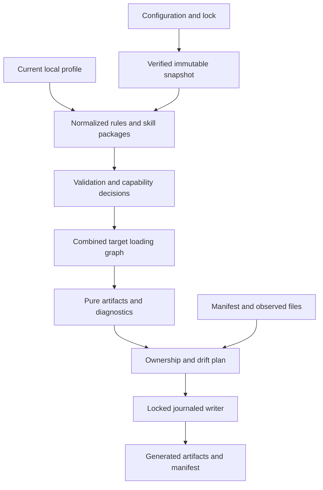

# Veritas technical implementation design

Veritas has one pure compilation pipeline and one controlled effect layer. Locked upstream snapshots plus current project additions become a normalized model, then a combined-target artifact set. A filesystem planner compares that set with observed ownership, and a recoverable writer applies only a conflict-free plan.

## Package and module boundaries

```text
src/
  cli/          commands, options, JSON output, exit codes
  config/       project, library, lock and manifest schemas
  sources/      local snapshots, Git transport, content cache
  parsing/      Markdown boundaries, YAML, source locations
  model/        shared contracts and canonical hashes
  validation/   identities, patterns, references, resource limits
  compiler/     profile selection, capability decisions, loading graph
  adapters/     codex/, claude/, kiro/ pure renderers
  sync/         observed state, plan, lock, journal, apply, recover
  index.ts      reusable core exports, no CLI side effects
  bin.ts        CLI entry point with node shebang
```

Use one package with `dist/bin.js` as its binary and `dist/index.js` plus declarations as its core export. Compile with TypeScript NodeNext resolution and strict checks. No import should initialize the CLI, read the environment, fetch a source, or mutate a repository. Inject filesystem, source-cache, Git-runner, and failure-point interfaces at effect boundaries. Fixtures live under `tests/fixtures/`; unit, integration, and package tests use separate suites.



## Project configuration contract

`veritas.yaml` uses schemaVersion 1. Every object rejects unknown fields. Exactly one `sources` entry is allowed; namespace names are lowercase ASCII identifiers. `profile` is `<namespace>/<profile-id>`. Target IDs are `codex`, `claude`, `kiro-ide`, or `kiro-cli`; each has an explicit bundled profile version. Selecting both Kiro surfaces compiles one identical artifact set with both consumer identities, or fails if their renderings differ.

```yaml
schemaVersion: 1
sources:
  company:
    git: ssh://git@git.example.com/platform/standards.git
    ref: v1.2.0
profile: company/baseline
targets:
  - id: codex
    profile: codex-repo-v1
  - id: claude
    profile: claude-repo-v1
  - id: kiro-ide
    profile: kiro-ide-repo-v1
local:
  path: .veritas/local
  profile: project
compatibility:
  adaptations: []
```

A local upstream replaces `git` and `ref` with `path: ../company-standards`. Resolve a local upstream relative to the config file; it may be outside the repository as an explicit read input. `local.path` stays within the project and points to another `veritas.library.yaml`. No shell expansion, environment interpolation, executable config, implicit parent discovery, or source-provided install hook. `--project` selects an explicit root; otherwise use the current Git root, falling back to cwd. Do not traverse into another Git root during output planning.

Config is bounded to 1 MiB; YAML rejects duplicate keys, custom tags, merges, and aliases. All content text is valid UTF-8. Reject UTF-8 BOMs in manifests and selected Markdown rather than silently moving the frontmatter boundary. Resource limits are fixed compiler-profile inputs, not source-controlled overrides: 1 MiB per steering/SKILL document; 10 MiB per asset; 100 MiB per complete snapshot; 10,000 entries; 16 directory levels; 1,000 rules and 1,000 skills. Report the exact violating source, not a generic parse error. TASK-003 may lower documented defaults if fixtures expose unreasonable resource usage, with contract updates.

## Library and identity contract

```yaml
schemaVersion: 1
steering:
  - id: baseline
    path: steering/baseline.md
  - id: ts-quality
    path: steering/typescript.md
skills:
  - name: company-review
    path: skills/company-review
profiles:
  baseline:
    steering: [baseline]
    skills: [company-review]
  typescript:
    steering: [baseline, ts-quality]
    skills: [company-review]
```

Profiles are explicit selections, not inheritance. Validate all manifest declarations and profile references; parse every selected package completely. Unselected file bodies need not be parsed, but snapshot paths and modes remain safe. IDs use `[a-z0-9]+(?:-[a-z0-9]+)*`, max 64 characters. Rule ID in frontmatter must match the manifest declaration. Qualified rule identity is `<source-namespace>/<id>`; local rules use reserved namespace `local`. No duplicate declared IDs, duplicate profile selections, output names, or selected skill names. Duplicate skill names across upstream and local packages fail even when their bytes match. Do not rewrite skill names to solve a collision.

Canonical steering has `id`, non-empty `description`, `activation`, optional `targets` and typed `extensions`. `activation` is a discriminated union: `always`; `files` with non-empty positive patterns; `manual`; `auto` using the rule description for relevance. Canonical Markdown bodies remain source slices: remove the frontmatter and normalize CRLF to LF, but do not pretty-print prose or reserialize a Markdown tree. Preserve text order within each body; canonical source IDs determine rule ordering, not filesystem enumeration order.

In canonical steering, harness-specific import directives outside code spans/fences are rejected, including file-like `@path` tokens and Kiro `#[[file:...]]`/`#[[folder:...]]` forms. v0.1 ordinary Markdown links are references, not automatic native imports. Diagnose the exact token and suggest literal code formatting or a future typed import feature. This prevents an adapter from silently enabling body-level loading semantics. Natural-language instructions are not semantically verified.

Skills follow the Agent Skills schema and name-to-directory contract. Read the entire selected directory, preserving asset bytes and relative structure. Optional known standard fields are validated; unknown top-level frontmatter fields fail unless they are implemented, explicitly typed target extensions. Do not strip a control and keep compiling. Sidecars such as `agents/openai.yaml` are inspected for supported invocation/tool controls; an unsupported selected consumer makes the package incompatible. A target-native-only skill may declare supported consumers in the library entry; it is omitted from other targets as explicit selection, not a loss adaptation.

Parse Markdown link/definition destinations in selected Markdown package files. Relative asset references must resolve within the same package, after decoding once, with no escape; query and fragment components do not change file existence checks. Fragment-only links are preserved; v0.1 does not certify heading anchor IDs. Standard external HTTPS and mail links are not fetched. Recognized code strings and prose paths are not exhaustive references; the guarantee concerns files and parsed link destinations. README and license files travel with the package. Never execute scripts to validate them.

## Paths, patterns, hashes and permissions

Source discovery finds declared entries; it does not evaluate activation intent. Sort all traversal and glob results using ordinal normalized POSIX paths. Activation grammar allows relative positive `/` paths, `*`, `**`, and `?`; reject negation, extglobs, braces, brackets, backslashes, leading slashes, drive prefixes, empty segments, and `.`/`..` segments. Treat dotfiles as ordinary names in Veritas's fixture matcher, with case-sensitive matching. An adapter may label patterns native only after its profile establishes the same tested behavior; uncertain edge cases produce unsupported diagnostics. A pattern matching no current project file emits a warning but remains in output.

`*` matches zero or more non-separator characters within one segment; `?` matches one. `**` must occupy a complete segment and matches zero or more path segments. A list is a positive OR union. Reject embedded double-star forms such as `foo**bar` rather than assigning undocumented semantics.

All managed paths are relative and portable: NFC Unicode, `/` separators, no NUL, Windows reserved names or trailing dot/space, control characters, colon, or case-folded collisions. Reject paths that overlap a directory/file destination, Git metadata, control files, or runtime state. Output allowlist is root AGENTS.md and CLAUDE.md, `.agents/skills/`, `.claude/rules/`, `.claude/skills/`, `.kiro/steering/`, `.kiro/skills/`. Never let a manifest path grant additional write authority.

Use SHA-256 over raw artifact bytes. A directory tree digest uses canonical JSON array entries sorted by normalized path, each containing `{path, sha256, executable}`. Snapshot entries are ordinary files only; reject symlinks, local hardlinked files (`nlink > 1`), devices, sockets, Git submodules, executable config, setuid/setgid/sticky modes, and unsafe ancestors. On POSIX normalize output modes to 0644 or 0755 based on source executable intent. On Windows record executable intent in snapshots/manifests but do not falsely report a chmod drift the filesystem cannot represent. Hash identity includes that intent, compiler outputVersion, and adapter-profile versions.

No timestamps, absolute source paths, transaction IDs, or credentials occur in deterministic artifacts, lock provenance fields, or the ownership manifest. Machine state may contain such values, separately. JSON uses stable keys, two spaces, UTF-8, LF and a trailing newline. Diagnostics sort by severity, code, source identity/path/location, and target. Generated steering uses stable provenance comments and minimal native frontmatter; skill assets are copied byte-for-byte except SKILL frontmatter transforms explicitly covered by an accepted target extension.

## Locks and source snapshots

`veritas.lock.json` schemaVersion 1 contains one source `{namespace, kind, requestedRef?, resolvedCommit?, treeDigest}`, project source-descriptor digest, compiler `{outputVersion}`, and exact target/profile versions. Git commit length follows the repository object format rather than assuming only 40-character SHA-1. Config source descriptors are hashed using portable relative local paths or normalized non-secret Git locators; embedded passwords/tokens in URLs are rejected. The current CLI package version is diagnostic metadata, not an arbitrary output hash input: a binary whose outputVersion/profiles do not match the lock refuses regeneration and asks for explicit update.

Snapshots reside under `.veritas/runtime/cache/<treeDigest>/` with a canonical inventory. Cache integrity is checked before use; missing/corrupt cache yields a clear error and never falls back to current source bytes. `init`/`update` populate snapshots. Plan/check/validate do not fill caches, fetch, or change locks. For cache restoration use `update --restore`: fetch or read the locked commit/tree, verify its existing digest, and leave the lock unchanged. Restoring a missing local snapshot requires local source bytes to match the locked digest; otherwise select an intentional update.

Git transport invokes the user's Git with argv arrays, no shell. Resolve the requested ref explicitly, then fetch/extract that object into a worktree-local bare cache; do not checkout a source worktree, initialize submodules, or execute hooks. Disable hooks and nonessential filters for these temporary source operations, while preserving ordinary SSH/credential helper authentication. Validate extracted entries before materialization; do not blindly unpack an archive into a destination. Handle option-like refs, Git LFS pointer files, network timeout, missing Git, auth failure, and object-format differences explicitly. LFS pointers are rejected as unavailable payload rather than silently copied.

Existing lock source descriptors or profiles disagreeing with config produce LOCK_MISMATCH. Upstream profile selection may change without fetching if the snapshot contains the requested valid profile; input identity changes accordingly. Only source descriptor/compiler-profile changes require lock update. Current local additions contribute their own tree digest and selected profile to `inputDigest` but not upstream source pinning.

Accept only HTTPS, SSH, or validated scp-style Git locators without embedded credentials. Reject executable/ext transport and unsafe option-like locators; disable unneeded Git protocols. Local bare repositories are injected test transports, not permission to enable arbitrary production transports. Set transport timeout and cache-size budgets, including streamed extraction limits; do not claim that a fetched repository cannot transfer large objects before tree validation.

## Core contracts

```ts
type Compatibility = 'native' | 'adapted' | 'unsupported';
type Diagnostic = {
  code: string; severity: 'error' | 'warning' | 'info'; message: string;
  source?: { id: string; path: string; line?: number; column?: number };
  target?: string; remediation?: string;
};
type Artifact = {
  path: string; bytes: Uint8Array; executable: boolean;
  sourceIds: readonly string[]; consumers: readonly string[];
};
type CompileResult = {
  artifacts: readonly Artifact[]; diagnostics: readonly Diagnostic[];
  compatibility: readonly RuleTargetResult[]; inputDigest: string;
};
type Operation = {
  kind: 'create' | 'replace' | 'delete' | 'unchanged' | 'conflict';
  path: string; expectedBefore: ObservedFileState; after?: Artifact;
};
```

`RuleTargetResult`, `ObservedFileState`, manifest, snapshot, and journal unions must be frozen by TASK-003. Use immutable normalized values and structured diagnostics, not exceptions for expected content errors. Unexpected operational failures are typed separately and converted by the CLI. Source positions are 1-based for users regardless of parser/tool offsets.

The adapter contract accepts normalized eligible rules/skills plus shared-output decisions and its fixed capability profile. It returns in-memory artifacts, loading edges, and diagnostics. It never chooses the shared baseline itself. The compiler retains source identities and accepted adaptations in the result even if an artifact combines several rules.

## Combined target compilation

For each rule, derive intended consumers from its targets intersected with the project target set. Evaluate capabilities before rendering. Selected targets outside a rule's restriction have no output for that rule; profiles with zero consumers warn. Build a loading graph of target -> artifact -> imported artifact -> rule identities. Require exactly one effective loading route per intended always-on rule, zero routes for excluded consumers, and the declared native route for conditional/manual/auto modes.

Codex output needs an AGENTS baseline. If Claude or Kiro is selected, every entry in that shared baseline must also be intended for those consumers. A Codex-only baseline beside Kiro therefore fails. Other always rules can use `.claude/rules/<namespace>--<id>.md` or `.kiro/steering/<namespace>--<id>.md`. If Codex is absent, prefer target-native outputs rather than exposing a new shared AGENTS file unnecessarily. Emit CLAUDE.md importing AGENTS only when Claude consumes the generated shared baseline. Shared always text is not duplicated in native rules.

The first conservative mapping is: always native for all profiles; files native for certified Claude/Kiro pattern cases and unsupported for Codex; manual/auto native only for supported Kiro profiles and unsupported for Codex/Claude steering. Standard skills get their native target placement with package controls checked separately. Explicit file-to-always adaptation is configured by exact rule ID and target, emits an adapted diagnostic, and still passes all consumer checks. Unknown, stale, duplicate, or irrelevant adaptation declarations fail. Nothing automatically emits nested AGENTS or AGENTS.override.

Inventory pre-existing root/nested instruction files, skills, and native rule directories, including ignored/symlinked entries. Planned path collisions are hard errors. Additional unmanaged instruction files generate deterministic warnings that full loading certification is limited; they are never deleted. A pre-existing AGENTS.override.md or root competing `.claude/CLAUDE.md` that shadows the planned baseline is a hard error. External global instructions and nondefault harness settings are outside ownership and prevent unqualified runtime certification.

## Manifest and drift plan

`.veritas/manifest.json` schemaVersion 1 contains `outputVersion`, profile versions, `inputDigest`, accepted adaptations, and sorted artifact entries `{path, sha256, executable, sourceIds, consumers}`. It is deterministic, has no runtime metadata, and uses the same strict path allowlist as fresh output. Without a manifest, every existing desired output is unmanaged. Identical unmanaged content still conflicts; no implicit adoption.

| Prior ownership | Current observation | Desired output | Operation |
| --- | --- | --- | --- |
| None | Missing | Present | Create |
| None | Any existing file/link | Present | Conflict |
| Managed | Matches recorded bytes/mode | Same | Unchanged |
| Managed | Matches recorded bytes/mode | Different | Replace |
| Managed | Matches recorded bytes/mode | Absent | Delete |
| Managed | Missing | Present | Create with missing drift |
| Managed | Missing | Absent | Remove manifest entry |
| Managed | Changed bytes/mode or unsafe kind | Any | Conflict |

Manifest-only provenance changes are drift even when all output bytes match. Invalid/corrupt manifests fail; do not treat them as absent. If the deterministic desired manifest equals current manifest and every output is unchanged, sync leaves them untouched. Never delete unlisted extra files in a skill folder; stale owned files can be removed individually only when safe. Prune only newly empty managed parent directories, never the root or unrelated contents.

## Apply, concurrency and recovery

1. Create `.veritas/runtime/sync.lock` exclusively, storing a random nonce and process identity. One mutator at a time, including init/update/recover. No TTL-based automatic lock stealing. Read-only commands report incomplete transactions and do not recover them.
2. Re-resolve current config/lock/local inputs and build a fresh complete plan under the lock. Capture manifest and every output precondition: absence or ordinary file hash/mode. Recheck ancestor kinds and allowlisted paths. Any conflict aborts before output writes.
3. Stage bytes and backups in an exclusive repository-local transaction directory. Complete and fsync stage files; persist a bounded schema-validated journal with before/after inventories and original manifest backup. Journal records only managed relative paths; stage/backup locations are derived, not trusted arbitrary paths.
4. Recheck each precondition immediately before writing/deleting and use same-filesystem atomic rename for replacements. Reject unsafe or externally changed destinations. Fault injection hooks are test-only dependencies, never a source option.
5. Write the deterministic manifest using atomic replacement last. Its desired digest is the transaction commit point. Fsync supported file/directory boundaries; document platform limits rather than claiming power-loss durability everywhere.
6. Remove journal/backups and release only the lock carrying this invocation's nonce. A cleanup failure leaves a recognizable committed transaction and emits a recovery-needed error.

`recover` validates the journal, current manifest, backups, and all affected current files before any action. If current manifest equals the desired digest and outputs match after-state, only cleanup remains. If it equals the prior digest (or prior absence), roll back operations whose current bytes match recorded before/after state, restoring original bytes and modes and removing only newly created files. If any artifact was edited after interruption or a manifest/journal is inconsistent, report conflict and preserve evidence for manual resolution. Recovery itself has preconditions and is restartable; recovery tests cover repeated interruption.

When prior and desired manifest digests are equal, such as recreating a missing output, the manifest alone cannot distinguish phases. If every output matches after-state, validated cleanup is safe; otherwise roll back a validated mix of before/after states. Unexpected states still conflict. Include this equal-digest case in failure injection rather than assuming every sync changes manifest bytes.

A stale lock with a live or unverifiable process is not removed. `recover --unlock` is an explicit local-owner action for a confirmed abandoned nonce; it does not authorize overriding file conflicts. Stale lock handling across Windows/process restarts must be tested before this option is offered. Local malicious races against ancestor checks are outside a JavaScript tool's sandbox guarantee; use ordinary trusted repository filesystems, no output through symlink ancestors.

## CLI contract

| Command | Source/network behavior | Project changes | Successful result |
| --- | --- | --- | --- |
| init | Explicit source resolution | New config and lock; cache | Inventory and initialized selection, no generated artifacts |
| update | Resolve requested ref/tree | Lock/cache only | Old/new provenance and pending-generation summary |
| update --restore | Restore exact locked input | Cache only | Existing lock preserved byte-for-byte |
| validate | Locked cache/local reads | None | Schemas/packages/capabilities/composition valid |
| plan | Locked cache/local/output reads | None | Full ordered operations, conflicts and diagnostics |
| sync | Locked cache/local reads | Safe generated artifacts and manifest | Applied plan or no-op |
| check | Same as plan | None | No output/manifest drift |
| recover | No source fetch | Safe rollback/cleanup only | Interrupted state resolved |

All commands support `--project` and `--json`; subcommand help shows inherited options. Init requires `--targets` and either `--source` with `--profile` or `--scaffold [dir]` (default `.veritas/library`), with no target defaults. `--scaffold` creates a two-file starter library (manifest plus one `always` steering file) by exclusive create, uses namespace `repo` and profile `repo/baseline`, refuses an existing directory and rolls its files back if initialization fails. `adopt <path> [--id --description --targets]` copies one steering file or skill directory into the project library (the `local` additions library, else a project-local path source), adds manifest and profile entries, validates with the library parser, and rolls everything back on failure; it maps Kiro `inclusion` and Claude `paths`, expands brace patterns, restricts rules to targets whose profile natively supports their activation, and never modifies or removes the original. Library files are written only by `src/sync/authoring.ts` (exclusive create, byte-checked manifest rewrite). `plan`/`check --diff` add bounded unified diffs for replace and conflict operations (`operations[].diff` in JSON). Library activation patterns may use `{a,b}` groups; schema parsing expands them to plain patterns (cap 100, hostile input left unexpanded so validation rejects it). Routine commands warn `SOURCE_STALE` when a local-path source differs from its locked snapshot. Templates replace the fixed `veritas.yaml` only after a supported initialization establishes its lock; the CLI does not accept a config template flag. Changing the source descriptor or target/profile contract requires explicit update. Paths for config/lock/manifest remain fixed in v0.1. JSON envelope has `{schemaVersion: 1, command, outcome, diagnostics, data}`. JSON stdout contains one full result object and JSON stderr is empty. Human stdout contains concise command summaries, with changed/conflicting paths in plan and drift checks; diagnostics and available remediation go to stderr. Clean check/sync reports that files and manifest are up to date. Failed sync retains the refused plan's original diagnostics plus PLAN_CONFLICT and its remediation, and includes that plan in JSON data. No color or unstable stack traces in JSON. Do not print credentials or full Git environment. Every user-correctable failure should carry a `remediation` that names the next command or edit; raw Git stderr is never echoed, only classified into fixed hints (`gitFailureHint`). `--project` must name an existing directory (`PROJECT_NOT_FOUND`). Init emits warning `RUNTIME_NOT_IGNORED` when Git positively reports `.veritas/runtime` as not ignored; it never edits `.gitignore`. [docs/troubleshooting.md](troubleshooting.md) indexes diagnostic codes with causes and fixes and ships in the package.

The distribution includes the user guide, compatibility matrix and declarative example library, local overlay and config templates. Their relative documentation links must resolve in the installed package; historical/source-only evidence links may point to the existing release tag. Example verification scripts remain checkout tools and are not packaged. The packed CLI walkthrough must exercise baseline initialization before copying the Codex adaptation template.

Exit codes: 0 success (plan may include ordinary changes); 1 check drift; 2 invalid content/config/compatibility; 3 ownership or unsafe-path conflict; 4 source/cache/operational failure; 5 busy/incomplete transaction requiring recovery. Errors outrank drift in this order: conflict/incomplete state, invalid content, operational failure, drift; the CLI reports all safely collectable diagnostics while returning one documented code. `plan` returns 3 for conflicts; `sync` never applies a partial conflict-free subset. Help/version do not touch the filesystem. `sync` authorization is the explicit command; preview is available through plan, with no interactive prompt required.

## Control file transactions

The journal is a strict tagged union: `sync`, `init`, or `update`. Generated-output allowlists never authorize control-file writes. The control writer has a separate fixed allowlist of veritas.yaml and veritas.lock.json. Init stages both new files, verifies absence again, writes config first and lock last as its commit point. Update atomically replaces only the validated existing lock, with the new lock digest as commit point; cache staging is independent and content-addressed. Recovery uses the journal kind to choose allowed paths, before/after preconditions, and commit digest. It restores/removes only files recorded by that transaction. A config or lock edited after interruption blocks recovery. Test interruption between init's files and around update's lock replacement.

Explicit adaptation shape:

```yaml
compatibility:
  adaptations:
    - rule: company/ts-quality
      target: codex
      kind: files-to-always
```

Rule and skill target restrictions are arrays of target IDs. Shared AGENTS contains only rules intended for every selected consumer of that file. Observed outputs with multiple hardlinks conflict. Git snapshots derive executable intent from tree modes, not extraction umask. The precise error precedence is exit 5, then 3, then 2, then 4, then 1; manifest corruption is an ownership conflict.

## Frozen implementation API (TASK-003)

The tested TypeScript definitions in `src/model/types.ts` and strict schemas in `src/config/schemas.ts` are the shared contract implementation. outputVersion is 1. `Result<T>` is a discriminated success/value/diagnostics or failure/diagnostics union. Expected content errors return it; effect errors use `VeritasError` carrying a structured diagnostic and exit code. Snapshot files carry relative path, bytes and executable intent. Normalized rule IDs are qualified; skill names stay native while their source.id is qualified. No module import performs repository I/O.

Parallel module exports:

- `src/parsing/library.ts`: `parseLibrary(snapshot: Snapshot, namespace: string, profile: string): Result<NormalizedLibrary>`. It validates declarations and selected package contents.
- `src/sources/local.ts`: `createLocalSnapshot(root: string): Promise<Snapshot>`.
- `src/sources/cache.ts`: `storeSnapshot(project: string, snapshot: Snapshot): Promise<void>` and `loadSnapshot(project: string, treeDigest: string): Promise<Snapshot>`. Cache population is explicit; load never fills it.
- `src/adapters/codex/index.ts`, `claude/index.ts`, `kiro/index.ts`: `renderCodex`, `renderClaude`, `renderKiro`, each `(input: AdapterInput): AdapterResult`. Compiler determines eligibility/adaptation and shared IDs first; adapters omit shared bodies and expose loading edges. The compiler selects shared AGENTS contents and delegates their pure rendering to Codex; no adapter chooses baseline membership.
- `src/sync/manifest.ts`: `createManifest(result: CompileResult): Manifest`.
- `src/sync/plan.ts`: `plan(project: string, result: CompileResult): Promise<WritePlan>`.

The planner/writer owner may define effect helper signatures inside its owned modules, keeping WritePlan, observed states and the journal tagged union unchanged. Journals include the commit entry and derive backup/stage names by entry index. Only sync entries can address generated output plus the fixed manifest; only init/update entries can address their fixed controls.

The Kiro CLI capability profile describes V3 full inclusion behavior. Legacy V1/V2 and custom-agent resource configuration are outside the selected profile; live harness version certification remains deferred.
